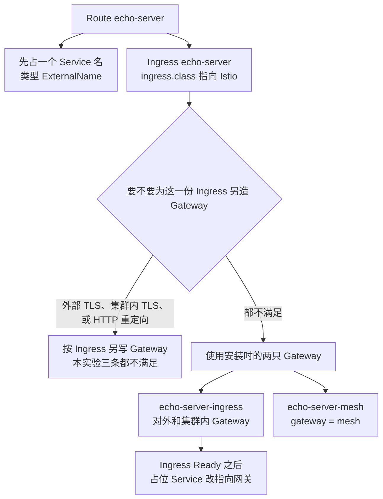

# 入口这一层：一份 Ingress，两份 VirtualService

总图在 [overview.md](./overview.md)。Route 控制器写 Ingress。`net-istio-controller` 把 Ingress 收成 VirtualService。Route 不写 VirtualService。源码是 Serving `7ed4aa2ab601` 和 net-istio `25e9acac1720`，tag 都是 `knative-v1.23.0`。

Ingress 与 Route 同名。过滤器读的注解是 `networking.knative.dev/ingress.class`，值要等于 `istio.ingress.networking.knative.dev`。注解缺失也会被收下。连字符形式 `ingress-class` 写在 Service 或 Route 上，由 Serving 翻译成点号形式，过滤器不直接读它。

generation 刚变化、Ingress 还没跟上时，Route 先标未配置，避免用上一轮的 Ready 报告这一代。流量算不出来时不写子对象。

| 条件 | 本实验 | 结果 |
|---|---|---|
| Ingress 对外且带外部 TLS | 否 | 不复制证书，不写按 Ingress 分的 TLS Gateway |
| 集群内 TLS 打开且 Ingress 带了集群内证书 | 否 | 不写集群内 TLS Gateway |
| 对外，且 HTTP 要重定向或已经有外部 TLS | 否 | 不写单独的 HTTP Gateway |
| 以上都不是 | 是 | 把代码里的默认 Gateway 放进 VirtualService |

`config-istio` 里的 Gateway 示例整段在 `_example` 中，不生效。代码默认值是：

| 用途 | Gateway | 背后的 Service |
|---|---|---|
| 对外 | `knative-serving/knative-ingress-gateway` | `istio-ingressgateway.istio-system.svc.cluster.local` |
| 集群内 | `knative-serving/knative-local-gateway` | `knative-local-gateway.istio-system.svc.cluster.local` |

这两只 Gateway 由安装清单创建，所有 Ingress 共用。kind 上没有云负载均衡，`istio-ingressgateway` 被改成 NodePort。宿主机 `18080` 对应节点端口 `31080`。选路靠 Host，不靠这个端口。

| VirtualService | gateways | hosts 里有什么 |
|---|---|---|
| `echo-server-ingress` | 上面两只 Knative Gateway | 含 `echo-server.default.example.com`，也含集群内名字 |
| `echo-server-mesh` | `mesh` | 只有 `echo-server.default` 和 `svc` 名，没有 `example.com` |

`enable-mesh-pod-addressability` 没有打开，所以不会出现按 Revision 命名的第三份 VirtualService。缩到零不删除这两份。public Endpoints 改指向 Activator 是 SKS 控制器做的，见 [revision-children.md](./revision-children.md)。

CertificateProvisioned 为 True、reason `TLSNotEnabled`，表示外部 TLS 没开。
