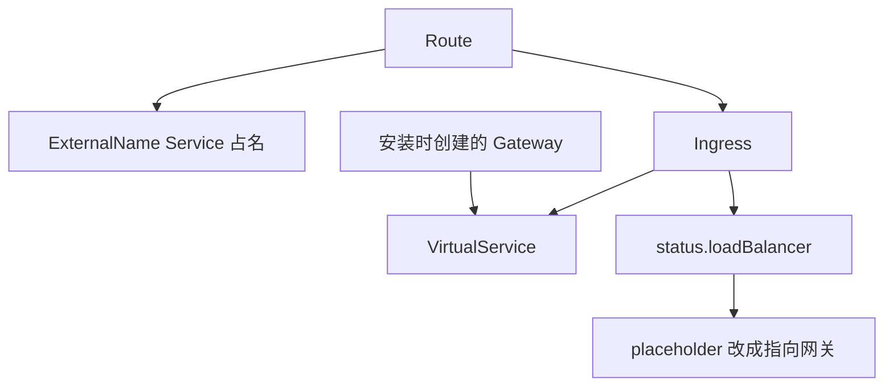

# net-istio 如何把 Ingress 收成 VirtualService

这篇笔记说明 Route 控制器如何把流量写成 `networking.internal.knative.dev/v1alpha1 Ingress`，以及 `net-istio-controller` 如何只处理 Istio 这一类 Ingress，再写成 VirtualService。Service 到 Route 的上半段见 [Service 如何写出 Configuration 和 Route](service-reconcile.md)。Revision 侧的 public Service 见 [Revision 如何落下 Deployment 和 Service](revision-children.md)。

两份源码都钉在 tag `knative-v1.23.0`。Serving commit 是 `7ed4aa2ab601e3a33c6552285f6e0d910747351d`。net-istio commit 是 `25e9acac172051c3f9c8873fca520128fc9a1d3a`。

这篇停在控制面的对象边界。Gateway 上的 Envoy 怎么按 VirtualService 转发、Activator 怎么把请求送到 Pod，不在这里重写。

## Route 先占名字，再写 Ingress

Route 控制器在 Serving 的 `controller` 进程里，注册点是 `cmd/controller/main.go`。`pkg/reconciler/route/controller.go` 监听 Route 自己，以及 owner 是 Route 的 Kubernetes Service、Certificate 和 Ingress。Configuration 和 Revision 通过 tracker 入队，因为流量目标会指向它们。Route 控制器不 watch VirtualService，也不写它。

`ReconcileKind` 在 `pkg/reconciler/route/route.go`。generation 第一次被看到、还不等于 `status.observedGeneration` 时，先 `MarkIngressNotConfigured`。注释说明如果不先标未配置，创建 placeholder Service 失败时，可能在 Ingress 根本没更新的情况下把 observed generation 报上去，Ready 仍是 True。这个顺序是为了避免那次误报，对应过 `net-contour` 的 issue 238。

接着 `configureTraffic`。返回的 traffic 是 nil 或带错误时，不再写子资源。域名错误标 `RevisionTargetTrafficError`，其他错误标 `UnknownTrafficError`，然后把错误返回。流量目标算出来之后，Route 的 `status.address.url` 先写成集群内地址，scheme 是 `http`，host 来自 `K8sServiceFullname`。这是集群内地址，不是 `example.com` 上的对外 URL。对外 URL 要等 Ingress 的负载均衡状态回来再传播。

然后是三件写回，顺序不能颠倒。

1. `reconcilePlaceholderServices`。每个流量目标一份 Kubernetes Service。`MakeK8sPlaceholderService` 把类型设成 `ExternalName`，`externalName` 是按域名模板算出来的名字，端口名是 h2c、端口 80。注释说明这是为了先占住名字，避免和别的控制器抢同一个 Service。owner 是 Route。
2. 外部域名 TLS。`cluster/up.sh` 不打开它。只开了外部 TLS、但一个证书都不需要时（主机全是集群内域名），标 `TLSNotEnabled`。集群内 TLS 由 `config-network` 的 `cluster-local-domain-tls` 控制，这个实验也没开，所以不会调用 `clusterLocalDomainTLS`。
3. `reconcileIngress`。ingress class 先看 Route 注解；注解为空就用 `config-network` 的默认 class。`cluster/up.sh` 把默认 class 设成 `istio.ingress.networking.knative.dev`。

Ingress 名字由 `pkg/reconciler/route/resources/names/names.go` 的 `Ingress` 给出，`ChildName` 的后缀是空字符串，所以与 Route 同名。`echo-server` 的 Ingress 就是 `ingress.networking.internal.knative.dev/echo-server`。

Ingress 自己的 generation 还没被观察到时，Route 再次 `MarkIngressNotConfigured`，不用旧 status。generation 相等、并且没有进行中的 rollout 时，才 `PropagateIngressStatus`。rollout 还没做完就标 `IngressRolloutInProgress`，即使前面的 Ingress 状态看起来已经就绪。注释说明 rollout 的优先级高于「Ingress 还没 Ready」那条分支，所以这行放在更新 placeholder 之后。

`updatePlaceholderServices` 在 Ingress 有负载均衡状态之后，把刚才的 ExternalName Service 收成指向网关的 Service，函数是 `MakeK8sService`。Ingress 还没有负载均衡地址时，placeholder 保持 ExternalName。缩到零不删除这些 Service，Route 仍要靠它们占住对外名字。



| 控制器 | 缓存里看什么 | 写回什么 |
| --- | --- | --- |
| Route，Serving `controller` | Route、owner 是它的 Service / Certificate / Ingress；Configuration 和 Revision 经 tracker | placeholder Service、可选 Certificate、Ingress、Route status |
| net-istio Ingress | 注解 class 命中或缺失的 Ingress，以及 owner 是 Ingress 的 VirtualService | VirtualService；外部 TLS 或 HTTP 重定向时才另写 Gateway。探测通过后写 Ingress 的 loadBalancer status |
| net-istio SKS | ServerlessService。`enable-mesh-pod-addressability` 为假时直接返回 | 这个开关打开才写 VirtualService 和 DestinationRule。本实验不写 |

## 过滤器读的是点号注解

`net-istio` 的 `cmd/controller/main.go` 启动两个构造函数：`ingress.NewController` 和 `serverlessservice.NewController`。Ingress 这一路才处理 Route 写下的 Ingress。

`pkg/reconciler/ingress/controller.go` 用 `networking.IngressClassAnnotationKey` 过滤。常量在 `vendor/knative.dev/networking/pkg/apis/networking/register.go`，值是 `networking.knative.dev/ingress.class`。必须等于 `istio.ingress.networking.knative.dev`，这个字符串是 `IstioIngressClassName`。第三个参数 `true` 表示注解缺失也收下，因此没标 class 的 Ingress 也会进这个控制器。

连字符形式 `networking.knative.dev/ingress-class` 是另一个常量 `IngressClassAnnotationAltKey`。注释说明它写在 Service 或 Route 上，Serving 再翻译成点号形式，方便不同 ingress 实现。过滤器不读连字符这一条。VirtualService 只有 owner 是这份 Ingress 时才把 owner 入队，别人创建的同名 VirtualService 不会把 Ingress 拉进来。

`ReconcileKind` 调 `reconcileIngress`。失败时 Ingress 标未就绪。函数开头对内存里的对象 `SetDefaults`，注释说明这只为了让后面的逻辑能假设默认值已经补上，不会把这份默认写回 API。

## 默认 HTTP 不给每个 Ingress 造 Gateway

`config-istio` 把 gateway 关掉时走 `reconcileMeshOnlyIngress`，只写 mesh VirtualService，不探测网关，loadBalancer 记成 mesh-only。`cluster/up.sh` 使用发布清单的默认配置，gateway 是开的，不走这条。

gateway 开着时，先从上下文取默认 Gateway，放进两个集合：集群内可见性和对外可见性。然后按三条独立条件决定要不要为这一份 Ingress 另造 Gateway。

| 条件 | 函数 | 本实验 |
| --- | --- | --- |
| Ingress 对外，并且带了外部 TLS | `shouldReconcileExternalDomainTLS` | 否。不复制证书 Secret，也不写按 Ingress 分的 TLS Gateway |
| 集群内 TLS 打开，并且 Ingress 带了集群内 TLS | `shouldReconcileClusterLocalDomainTLS` | 否 |
| Ingress 对外，并且 `HTTPOption` 为 Redirected，或者已经有外部 TLS | `shouldReconcileHTTPServer` | 否。没有外部 TLS，HTTP 选项也不是重定向 |

三条都不满足时，走 else：把默认的对外 Gateway 放进对外名字集合。注释写这是为了兼容旧行为。本实验因此不会创建 per-ingress Gateway。

默认 Gateway 不是 `config-istio` 里那块示例。`config/400-config-istio.yaml` 的 gateway 例子整段都在 `_example` 里，不生效。真正的默认值在 `pkg/reconciler/ingress/config/istio.go`。

| 用途 | namespace / 名字 | 背后的 Service |
| --- | --- | --- |
| 对外，`defaultIngressGateways` | `knative-serving/knative-ingress-gateway` | `istio-ingressgateway.istio-system.svc.cluster.local` |
| 集群内，`defaultLocalGateways` | `knative-serving/knative-local-gateway` | `knative-local-gateway.istio-system.svc.cluster.local` |

这两个 Gateway 对象由 net-istio 的安装清单 `config/202-gateway.yaml` 创建，所有 Ingress 共用。kind 上没有云负载均衡，`cluster/up.sh` 把 `istio-ingressgateway` 改成 NodePort，宿主机 `18080` 映射到节点端口 `31080`。访问时要带 Host 头，因为 VirtualService 按主机名选路由，不按节点端口选。

## 每个 Ingress 两份 VirtualService

`MakeVirtualServices` 用上面的 Gateway 名字集合产出两份对象。名字在 `pkg/reconciler/ingress/resources/names/names.go`。

| 对象 | 名字 | gateways | 给谁用 |
| --- | --- | --- | --- |
| Ingress VirtualService | Ingress 名字加 `-ingress` | 对外和集群内的默认 Gateway | 集群外和集群内通过 Gateway 进来的请求 |
| mesh VirtualService | Ingress 名字加 `-mesh` | `mesh` | 网格内 sidecar 直接访问。本实验没有打开全命名空间的 sidecar 注入 |

`echo-server` 对应 `virtualservice/echo-server-ingress` 和 `virtualservice/echo-server-mesh`。owner 都是 Ingress。`reconcileVirtualServices` 负责创建、更新和删掉不再需要的旧对象。写失败时 Ingress `MarkLoadBalancerFailed`，reason 为 virtual service 未 reconcile，然后返回错误。

写完先 `MarkNetworkConfigured`。Ingress 这一代已经 Ready 时跳过探测。注释说明 status manager 的缓存挡得住全局 resync，挡不住冷缓存的故障转移，跳过是为了避免一开机就对所有 Ingress 探测。还没 Ready 时调用 `statusManager.IsReady`，它通过 Gateway、Endpoints 和 Service 探测。探测失败返回错误。探测通过才 `MarkLoadBalancerReady`：对外和集群内各一份，地址来自默认 Gateway 的 Service URL，字段是 `domainInternal`，不是云厂商的 IP。探测不通过则 `MarkLoadBalancerNotReady`。

Route 下一轮看到 Ingress 的 observed generation 相等，才把这份负载均衡状态抬到 Route，并更新 placeholder Service。

## SKS 那条路在本实验里是空的

net-istio 的 SKS 控制器是另一条路。`enable-mesh-pod-addressability` 没打开时，`ReconcileKind` 直接返回，不为 SKS 写 VirtualService 或 DestinationRule。本实验不改这个开关，所以集群里不会出现按 Revision 命名的第三份 VirtualService。Revision 的 public / private Service 仍由 Serving 的 SKS 控制器写。

缩到零之后，Route 和 Ingress 保持 Ready。VirtualService 继续指向 public Service 的名字。public Endpoints 在没有用户 Pod 时改指向 Activator，这是 Serving 的 SKS 控制器做的，net-istio 不因为副本变成 0 而删除 VirtualService。

## 这次集群上的对象

Ingress `echo-server` Ready。注解 `networking.knative.dev/ingress.class` 是 `istio.ingress.networking.knative.dev`。集群里 `default` 命名空间只有两份 VirtualService。

`echo-server-ingress` 的 gateways 是 `knative-serving/knative-ingress-gateway` 和 `knative-serving/knative-local-gateway`。hosts 包括 `echo-server.default`、`echo-server.default.example.com`、`echo-server.default.svc` 和 `echo-server.default.svc.cluster.local`。

`echo-server-mesh` 的 gateway 是 `mesh`。hosts 包括 `echo-server.default`、`echo-server.default.svc` 和 `echo-server.default.svc.cluster.local`，没有 `example.com` 这一条。mesh 规则不对外发布域名。

没有第三份 VirtualService，也没有按 `echo-server-00001` 命名的 Gateway。Route 的 CertificateProvisioned 为 True，reason `TLSNotEnabled`。空闲、Pod 已经没有之后，Ingress 和两份 VirtualService 仍在，Route 的 URL 仍是 `http://echo-server.default.example.com`。

## 观察命令

```bash
kubectl --kubeconfig .kube/config -n default get ingress.networking.internal.knative.dev,virtualservice
kubectl --kubeconfig .kube/config -n default get virtualservice echo-server-ingress -o jsonpath='{.spec.gateways}{"\n"}{.spec.hosts}{"\n"}'
kubectl --kubeconfig .kube/config -n default get virtualservice echo-server-mesh -o jsonpath='{.spec.gateways}{"\n"}{.spec.hosts}{"\n"}'
```
