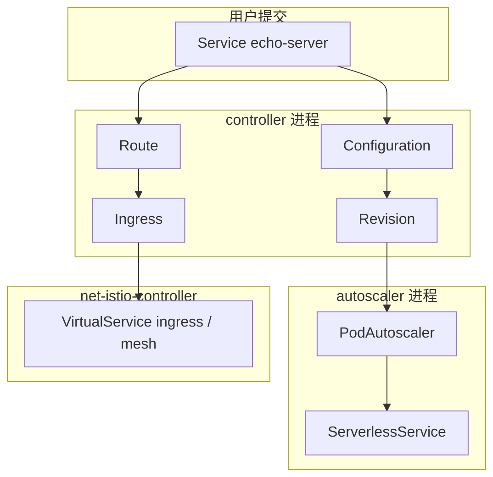

# 控制面三段怎么放在一起看

本仓库在 kind 集群 `knative` 上安装 Knative Serving `knative-v1.23.0` 和同一 tag 的 net-istio。Istio 用发布物里的 `istio.yaml`，ingress gateway 标的是 Istio 1.29.2。用户只提交一个 Service。后面的 Configuration、Revision、Route、Ingress 和 VirtualService 由控制器写出来。

| | Service / Configuration | Revision / KPA / SKS | Route / net-istio |
|---|---|---|---|
| 用户入口 | `serving.knative.dev/v1 Service` | 不直接提交 | 不直接提交 |
| 进程 | `controller` | Revision 和 SKS 在 `controller`，KPA 在 `autoscaler` | Route 在 `controller`，VirtualService 在 `net-istio-controller` |
| 写回 | 同名 Configuration、同名 Route、带 generation 的 Revision | Deployment、Image、PodAutoscaler、ServerlessService、public / private Service、public Endpoints | Ingress、占位 Service、`{name}-ingress` 和 `{name}-mesh` 两份 VirtualService |
| 本实验不写 | Pod、Endpoints、VirtualService | VirtualService、DestinationRule | 每个 Ingress 一份 Gateway；按 Revision 命名的 VirtualService |
| 文档 | [`service-reconcile.md`](./service-reconcile.md) | [`revision-children.md`](./revision-children.md) | [`kingress-to-virtualservice.md`](./kingress-to-virtualservice.md) |
| 本机 `echo-server` | Ready；latest Revision `echo-server-00001`；对外 URL `http://echo-server.default.example.com` | 空闲后没有 Pod；PodAutoscaler `desiredScale` / `actualScale` 为 0；SKS 仍是 Proxy，`numActivators` 为 3 | Ingress Ready；只有上述两份 VirtualService；CertificateProvisioned reason 是 `TLSNotEnabled` |

## 两条动手入口

kind 集群和示例 Service 都由仓库根目录的 `Makefile` 驱动。`make create` 缺集群时才创建，已有同名集群就留着，再装 Serving 和 Istio。`make verify` 提交 `manifests/echo-server.yaml`。

`make` 不安装 Eventing，也不访问集群外面的镜像仓库以外的付费 API。

## 不要混读的事实

- 本仓库是单节点 control-plane。宿主机端口是 `18080` / `18443`，对应节点端口 `31080` / `31443`。`8080` / `8443` 属于另一个 kind 集群 `k8s-lab`。不要把那边的端口或集群名抄过来，也不要为了凑两节点去重建 `knative`。
- `config-istio` 和 `config-autoscaler` 里 `_example` 下的键不是生效配置。Gateway 名和并发目标以代码缺省值为准，笔记里写了具体常量。
- `knative-v1.23.0` 的 `istio.yaml` 没有 `knative.dev/crd-install` 标签。按文档再跑一次带这个 selector 的 apply，kubectl 1.36 会因为没有对象而退出。`make create` 只 apply 整份清单一次。
- 默认 HTTP 不给每个 Ingress 另造 Gateway，也不为 SKS 写 VirtualService。`enable-mesh-pod-addressability` 没有打开。
- 缩到零之后，Service、Route、Ingress、Revision 的 Ready 仍是 True。PodAutoscaler 的 Ready 变成 False，reason 是 `NoTraffic`。SKS 的 Ready 变成 Unknown，reason 是 `NoHealthyBackends`。
- kind 节点里的 `127.0.0.1:1087` 不是宿主机上的代理。安装脚本把节点里的回环代理改成 `host.docker.internal`。另外要进节点的镜像用 `make load-image`，在宿主机 pull 再导入。
- 不要直接跑 `kind export kubeconfig --name knative`。这条会把 current-context 切到 `kind-knative`。用 `make register`。
