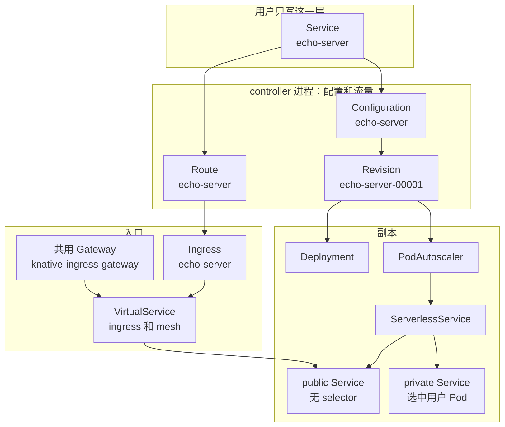
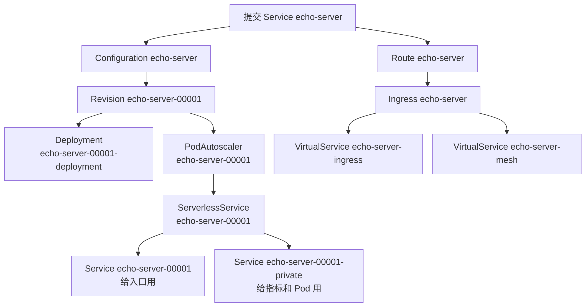
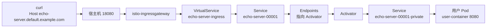
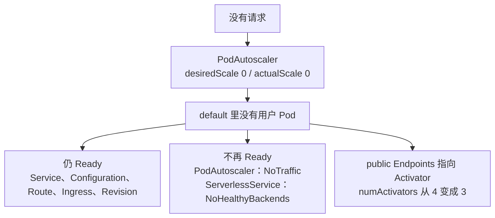

# Knative Serving 的对象是怎么拼起来的

## 背景

Kubernetes Deployment 负责把 Pod 跑起来。它不按 HTTP Host 选择一个可独立发布的版本，也不会在没有请求时把副本收到 0。

Knative Serving 在 Deployment 外面再加一层。用户只提交一份 `Service`。控制器把它拆成「配置的历史」「流量指向哪一版」「副本现在该有几个」「集群入口按哪个 Host 转发」。Istio 在这个实验里只承担最后一段：把 Knative 的 Ingress 收成 VirtualService。

数据面里 Activator 如何排队、Queue-Proxy 如何统计，写在 [Knative：Service、Revision 与 Scale-to-Zero](https://www.forrestisrunning.tech/article/knative)。这里只保留请求要经过的对象名字。

## 目标

用 `manifests/echo-server.yaml` 看清三件事。

1. 提交一份 Service 之后，多出来的对象分别是谁创建的。
2. `curl` 带上 Host 之后，请求经过哪些对象才到容器。
3. 没有请求之后，哪些对象还在，哪些 status 会变。

版本是 Knative Serving `knative-v1.23.0`（commit `7ed4aa2ab601`）和同一 tag 的 net-istio（commit `25e9acac1720`）。Istio 来自这份 net-istio 自带的 `istio.yaml`，gateway 镜像是 Istio 1.29.2。源码在 `~/Projects/learning/knative-serving` 和 `~/Projects/learning/knative-net-istio`。

## 官方图

下面四张图都钉在 Knative 1.23。前三张来自 [Serving 架构](https://knative.dev/docs/serving/architecture/) 和 [请求路径](https://knative.dev/docs/serving/request-flow/)，对象模型来自 [Serving 概述](https://knative.dev/docs/serving/) 引用的规范图。后面的小节把它们落到本机的 `echo-server` 上。

Service 拥有 Configuration 和 Route。Configuration 再拥有一份份不可变的 Revision。本实验只有第一代 `echo-server-00001`。


蓝色是 Knative 组件，橙色是网络层，黄色是用户容器。Controller 和 Webhook 管对象，不转发请求。Ingress Gateway 在 Proxy 模式进入 Activator，在 Serve 模式进入 Queue-Proxy。Activator 再通知 Autoscaler 把缩到零的 Revision 拉起来。本实验停在 Proxy。


`net-*` controller 监视 Knative Ingress，再去配置 Ingress Gateway。流量从这只 Gateway 前面的 Kubernetes Service 进来。本实验的 `net-*` 是 net-istio。kind 没有云负载均衡，所以没有用图里的 DNS 指向 LoadBalancer，而是用 Host 头访问节点端口 `31080`。


HTTP Router 有两条路。流量低或没有 Pod 时走 Activator；多余容量够大时直接进 Pod。两条路最后都经过 Queue-Proxy，再到用户容器。Autoscaler 在旁边看指标，不在每个请求上更新。`echo-server` 的多余突发容量是负的，所以走 Activator 那条。


[target burst capacity](https://knative.dev/docs/serving/load-balancing/target-burst-capacity/) 那一页把 `target-burst-capacity` 的默认写成 200。`knative-v1.23.0` 源码 `defaultConfig` 里的值是 211。本机 Activator 数量按 211 对得上，见 [revision-children.md](./revision-children.md)。

## 四层对象

同一份 `echo-server` 同时存在于四层。上面两层决定「发布哪一版、域名是什么」。下面两层决定「现在有没有 Pod、入口把 Host 送到哪」。



`Service`、`Configuration`、`Route` 同名。`Revision` 带 generation，第一代是 `echo-server-00001`。KPA 跑在 `autoscaler` 进程，其余 Serving 控制器跑在 `controller` 进程。VirtualService 只由 `net-istio-controller` 写。

| 层 | 谁写 | 写什么 | 不写什么 |
|---|---|---|---|
| Service | Service 控制器 | 同名 Configuration、同名 Route | Revision、Pod、Ingress |
| Configuration | Configuration 控制器 | `echo-server-00001` 这种 Revision | Deployment |
| Revision | Revision 控制器 | Deployment、Image、PodAutoscaler | Kubernetes Service |
| KPA | autoscaler | ServerlessService，并改 Deployment 副本 | Deployment 本身的创建 |
| SKS | SKS 控制器 | public Service、private Service、public Endpoints | VirtualService |
| Route | Route 控制器 | Ingress、占位用的 Kubernetes Service | VirtualService |
| net-istio | net-istio-controller | `{name}-ingress` 和 `{name}-mesh` | 本实验不另造 per-ingress Gateway |

每一层的分叉：

- Service 何时停下来不写 Route：[service-reconcile.md](./service-reconcile.md)
- 副本何时走 Proxy、Activator 数量怎么算：[revision-children.md](./revision-children.md)
- 为什么两份 VirtualService 共用安装时的 Gateway：[kingress-to-virtualservice.md](./kingress-to-virtualservice.md)

## 提交之后的生成顺序

图里有两条并行的分支。一条长出版本和副本，另一条长出域名和入口。Service 控制器自己不创建 Revision，它只保证 Configuration 存在，由 Configuration 控制器写下一代 Revision。



模板里没有写 Revision 名，所以名字由 generation 生成：`echo-server` 加 `-` 再加五位数字。准入会把容器名补成 `user-container`，流量补成指向最新 Revision 的 100%。Route 的 spec 里仍写 `configurationName: echo-server`。status 里才换成 `revisionName: echo-server-00001`。

对外 URL 是 `http://echo-server.default.example.com`。`status.address.url` 是另一条，`http://echo-server.default.svc.cluster.local`，只在集群内使用。

## 请求经过哪些对象

宿主机 `18080` 被 kind 送到节点端口 `31080`，也就是 `istio-ingressgateway` 的 http2 端口。VirtualService 按 Host 选择路由，所以要带 `Host: echo-server.default.example.com`。

本实验的 SKS 模式一直是 Proxy。原因在副本那一层：默认突发容量下，多余容量一开始是负数，不满足切到 Serve 的条件。Proxy 时 public Service 没有 selector，Endpoints 由 SKS 控制器写成 Activator 的地址。Activator 再访问 private Service，private Service 才选中用户 Pod。



`echo-server-mesh` 的 gateway 是 `mesh`，hosts 里没有 `example.com`。集群外的这只 `curl` 不走它。全命名空间的 sidecar 注入没有打开。

mesh 里 Pod 直接互访、以及 Queue-Proxy 上的并发统计，不在这张图里展开。

## 没有请求之后还留下什么

缩到零拿掉的是用户 Pod，不是对外的名字。Route、Ingress、两份 VirtualService 都还在。public Endpoints 改指向仍在运行的 Activator。private Service 已经没有就绪地址，所以 SKS 报没有健康后端。



| 对象 | 有 1 个就绪 Pod 时 | 空闲、Pod 没了之后 |
|---|---|---|
| Service / Configuration / Route / Ingress | Ready | 仍 Ready |
| Revision | Ready，Active True | Ready 仍 True，Active False |
| PodAutoscaler | desiredScale 1，actualScale 1，模式 Proxy，Activator 数 4 | desiredScale 0，actualScale 0，Ready False，reason `NoTraffic` |
| ServerlessService | Proxy，Activator 数 4 | 仍是 Proxy，Activator 数 3，Ready Unknown，reason `NoHealthyBackends` |
| VirtualService | `echo-server-ingress` 与 `echo-server-mesh` | 仍在，不因为副本变成 0 而删除 |

Activator 数来自默认值：目标并发 100，突发容量 211，单个 Activator 容量 100。1 个就绪 Pod 时是 `ceil((100 + 211) / 100) = 4`。0 个就绪 Pod 时是 `ceil(211 / 100) = 3`。算式和模式切换见 [revision-children.md](./revision-children.md)。

## 本机对象名单

| 对象 | 名字 |
|---|---|
| Service / Configuration / Route / Ingress | `echo-server` |
| Revision / PodAutoscaler / ServerlessService / public Service | `echo-server-00001` |
| Deployment | `echo-server-00001-deployment` |
| private Service | `echo-server-00001-private` |
| Image | `echo-server-00001-cache-user-container` |
| VirtualService | `echo-server-ingress`、`echo-server-mesh` |
| 对外 Gateway | `knative-serving/knative-ingress-gateway` |
| 集群内 Gateway | `knative-serving/knative-local-gateway` |

Route 的 CertificateProvisioned 为 True，reason 是 `TLSNotEnabled`。意思是没开外部 TLS，不是证书签发失败。Ingress 注解是 `networking.knative.dev/ingress.class=istio.ingress.networking.knative.dev`。没有第三份 VirtualService，也没有按 Revision 命名的 Gateway。

响应体是 `Hello World!`。镜像在清单里写 `ghcr.io/knative/helloworld-go:latest`，解析后的 digest 是 `ghcr.io/knative/helloworld-go@sha256:a97656c57f547d668318eb45c4c44c4cb0667892c055b40355b37859918c5c18`。

## 在集群里看

```bash
kubectl --kubeconfig .kube/config -n default get ksvc,configuration,route,revision,ingress.networking.internal.knative.dev,virtualservice
kubectl --kubeconfig .kube/config -n default get deploy,podautoscaler,serverlessservice,svc,endpoints
curl -H "Host: echo-server.default.example.com" http://127.0.0.1:18080
```

集群怎么创建、端口为什么是 `18080`，见 [cluster.md](./cluster.md)。
