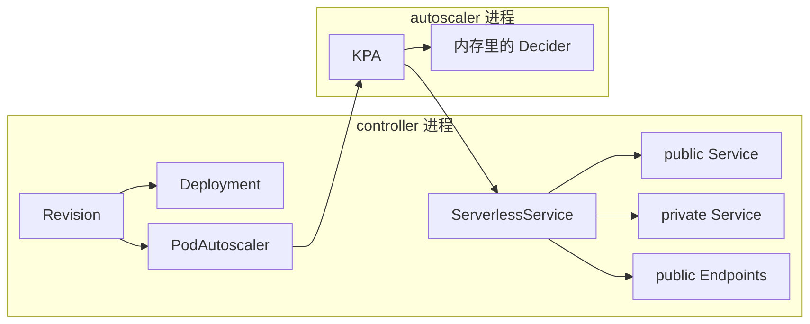
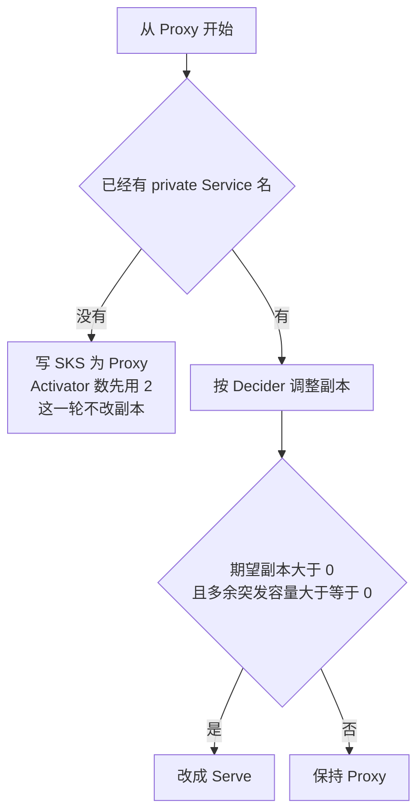
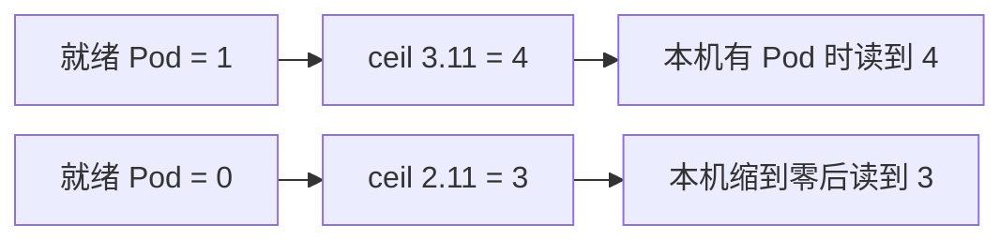
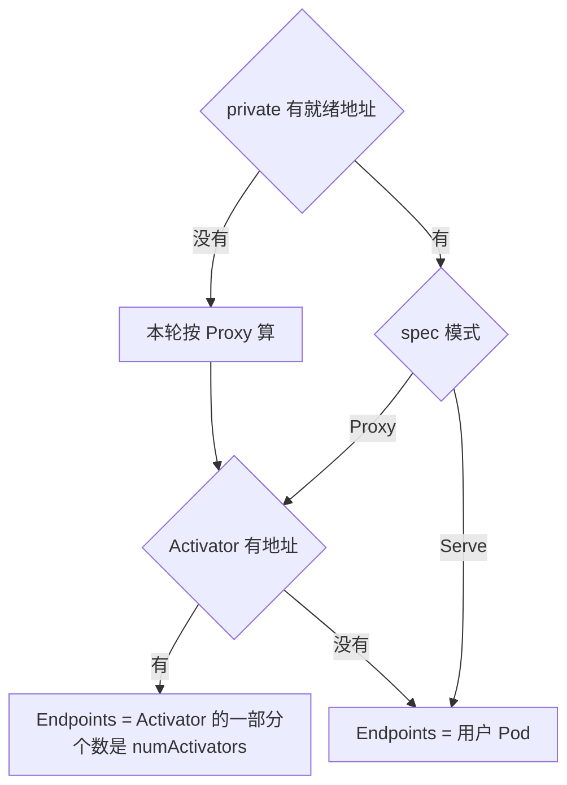

# 副本这一层：Proxy、Activator 数量、两份 Service

总图在 [overview.md](./overview.md)。三个进程接力。前一个只写自己的对象，下一个靠 Informer 看到新对象再继续。源码是 `knative-serving` 的 `knative-v1.23.0`，commit `7ed4aa2ab601`。

| 控制器 | 看什么 | 写什么 | 不写什么 |
|---|---|---|---|
| Revision | Revision，以及它拥有的 Deployment、PodAutoscaler | Deployment、Image、PodAutoscaler | Service、Endpoints、ServerlessService |
| KPA | class 为 `kpa.autoscaling.knative.dev` 的 PodAutoscaler | Decider、Metric、ServerlessService，并改 Deployment 副本 | 不创建 Deployment。没标 class 或标成 HPA 的对象不进这里 |
| SKS | ServerlessService 和它拥有的 Service、Endpoints | public Service、private Service、public Endpoints | 不改副本，不写 VirtualService |

镜像 digest 还没解析完时，Revision 停在 `ResolvingDigests`，这一轮不创建 Deployment。Deployment 刚创建时只标 Deploying 并返回，不在同一轮里等 Pod。别人占了同名 Deployment 或 PodAutoscaler，标 NotOwned，控制器不改那份对象。

class 不由 `MakePA` 写死。准入在注解缺失时写成 `kpa.autoscaling.knative.dev`。KPA 的过滤器不接收缺失注解。

## 模式

KPA 每一轮从 Proxy 起算，只有一个条件能把它改成 Serve：期望副本大于 0，并且多余突发容量大于等于 0。Serve 的含义是把 Activator 移出转发路径，public Endpoints 直接指向用户 Pod。

默认 `target-burst-capacity` 是 211，`initial-scale` 是 1，目标并发是 100。新建 Decider 时多余突发容量先记成 `1 * 100 - 211 = -111`。负数不满足 Serve，所以 `echo-server` 即使已经有 1 个 Pod，模式仍是 Proxy。

private Service 名还没有时，这一轮用 Proxy 和 Activator 下限 2 把 SKS 建出来，然后返回。2 不是后面那条算式的结果。

## Activator 数量

`target-burst-capacity` 大于 0 时，数量是 `ceil((就绪 Pod 数 * 100 + 211) / 100)`，并且至少为 2。本实验没有改 `config-autoscaler`，`_example` 里的键不生效，用的就是这组代码默认值。

`containerConcurrency` 为 0 时，目标并发取默认 100，不是百分比键上的 0.7。0.7 是另外一项：真正的稳定目标还要再乘 0.7。Activator 个数用的是乘之前的 100。

## Endpoints 指向谁

public Service 没有 selector，Endpoints 只能由 SKS 控制器写。private Service 的 selector 选中用户 Pod。

没有用户 Pod 时，private 侧没有就绪地址，条件是 `NoHealthyBackends`。Activator 进程仍在，public Endpoints 指向它们。VirtualService 继续指向 public Service 这个名字，不跟着副本数改。

| 本机 `echo-server-00001` | 刚就绪 | 空闲之后 |
|---|---|---|
| Deployment | `echo-server-00001-deployment` 1/1 | 没有用户 Pod |
| PodAutoscaler | 曾短暂为 desiredScale -1，随后 1/1，class 是 KPA | 0/0，Ready False，`NoTraffic` |
| ServerlessService | Proxy，Activator 数 4 | Proxy，Activator 数 3，Ready Unknown |
| Revision | Ready | Ready 仍 True，Active False |
