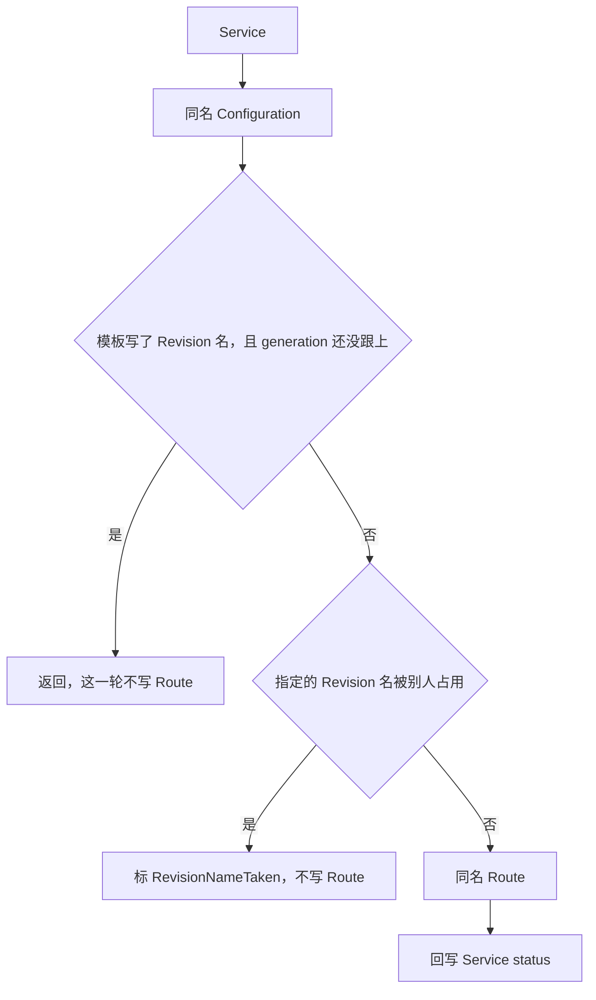

# Service 如何写出 Configuration 和 Route

这篇笔记说明用户提交一个 `serving.knative.dev/v1 Service` 之后，`controller` 进程如何保证同名 Configuration 和 Route 存在，以及 Configuration 控制器如何为当前 generation 再写一个 Revision。Revision 再往下写的 Deployment、PodAutoscaler 和两个 Kubernetes Service 见 [Revision 如何落下 Deployment 和 Service](revision-children.md)。Route 写出的 Ingress 如何变成 VirtualService 见 [net-istio 如何把 Ingress 收成 VirtualService](kingress-to-virtualservice.md)。

源码基线是本地 `knative-serving` 检出，tag `knative-v1.23.0`，commit `7ed4aa2ab601e3a33c6552285f6e0d910747351d`。

Service 是用户入口，不是数据面对象。它不创建 Pod，不写 Endpoints，也不写 VirtualService。它只保证两份子对象和自己的 status。缩到零、Activator 和 Queue-Proxy 不在这篇里。

## 进程里还有哪些控制器

`cmd/controller/main.go` 的 `ctors` 一次注册 9 个构造函数：`configuration`、`labeler`、`revision`、`route`、`serverlessservice`、`service`、`gc`、`nscert`、`domainmapping`。它们跑在同一个 `controller` 进程里。KPA 不在这份名单里，它由 `cmd/autoscaler/main.go` 调用 `kpa.NewController`。

这篇只用到 Service 和 Configuration。labeler 负责把正在接流量的 Revision 标成 active，gc 负责按策略删旧 Revision。这两条不展开。`main` 里的 `-reconciliation-timeout` 覆盖 `reconciler.DefaultTimeout`，每次 `ReconcileKind` 都用这个超时包一层 context。超时后 context 取消，进行中的 API 调用会失败并重试。源码没有在这个文件里写死超时秒数，运行值以进程参数为准。

## Service 控制器看什么

`pkg/reconciler/service/controller.go` 的 `NewController` 拿四份 Informer。

| 缓存里看什么 | 什么事件入队 | 写回什么 |
| --- | --- | --- |
| Service | 增删改直接入队 | 同名 Configuration、同名 Route，以及 Service status |
| Configuration | `FilterController(&v1.Service{})` 通过后，把 owner 入队 | 不直接写 Configuration 以外的对象 |
| Route | 同样只在 owner 是 Service 时把 owner 入队 | 不直接写 Route 以外的对象 |
| Revision | 只给 lister 用，不挂事件处理 | 不写 Revision |

Revision 不入队，是因为 Service 控制器只在 `CheckNameAvailability` 里按名字读它，不根据 Revision 的每次状态变化重新调度。Revision 就绪之后，Configuration 先改自己的 status，Configuration 的更新再把 Service 入队。所以 Service status 上的 `latestReadyRevisionName` 至少晚一轮。

名字函数在 `pkg/reconciler/service/resources/names/names.go`。`Configuration` 和 `Route` 都返回 Service 自己的名字，没有后缀。`manifests/echo-server.yaml` 因此对应 `configuration/echo-server` 和 `route/echo-server`。同名是所有权检查的前提：名字被别的对象占住时，控制器不会改 owner，只会在 Service 上标 NotOwned。

## 一轮先写 Configuration

`ReconcileKind` 在 `pkg/reconciler/service/service.go`。顺序固定：先 `Config`，再在 generation 和名字都允许时写 Route，最后用两边的 status 填 Service。任一步返回错误，这一轮停止，工作队列会重试。



`Config` 用 Service 名字取 Configuration，分四种结果。

1. NotFound。`MakeConfiguration` 再 Create。成功记一条 Normal 事件 `Created`。失败记 Warning 事件 `CreationFailed`，并把错误返回。
2. 其他读取错误。包一层 `failed to get Configuration` 返回，不改子对象。
3. 对象在，但 `metav1.IsControlledBy` 失败。`MarkConfigurationNotOwned`，返回错误。控制器不抢别人的 Configuration，也不删除它。
4. owner 正确。走 `reconcileConfiguration`。先对现有对象 `SetDefaults`，避免升级后新默认值造成无意义 Update。再 `MakeConfigurationFromExisting`。spec、labels、annotations 三者都相等才不动。有差就把这三块盖到现有对象上再 Update。ObjectMeta 里除 labels 和 annotations 以外的字段留在原对象上，包括 resourceVersion 和 uid。

`MakeConfigurationFromExisting` 把 `spec` 设成 `service.Spec.ConfigurationSpec`。labels 是 Service 原有 labels 再加 `serving.knative.dev/service` 和 `serving.knative.dev/serviceUID`。annotations 从 Service 抄过来，但丢掉 `kubectl.kubernetes.io/last-applied-configuration` 和 rollout duration。annotation `serving.knative.dev/routes` 是已有值再并上同名 Route，排序后用逗号接起来。owner 是这份 Service。

## generation 没跟上时，BYO 名字会挡住 Route

Configuration 的 `metadata.generation` 还不等于 `status.observedGeneration` 时，Service 被标成 Configuration 尚未 reconcile。这时子对象的 conditions 还是上一轮的，不能当成这一代的结果。

模板里如果写了 Revision 名字，也就是 BYO Revision，函数在这里 `return nil`。注释说明这是为了串行：等 Configuration 跟上这一代，再改流量。返回 nil 表示这一轮不算失败，不会因为错误重试；下一轮要等 Configuration 的更新事件把 Service 再入队。

模板没写名字时，generation 落后也不挡 Route。`echo-server` 的模板没有写 Revision 名，所以 Configuration 还在创建 `echo-server-00001` 时，Service 仍会继续保证 Route 存在。流量先指向 Configuration 名，等 `latestReadyRevisionName` 出现后再由 `checkRoutesNotReady` 判断是否已经落到具体 Revision。

## 指定 Revision 名时先检查能不能用

`CheckNameAvailability` 只在 `config.Spec.GetTemplate().Name` 非空时生效。空名字直接返回 nil。非空时按这个名字读 Revision。

| 读到的情况 | 返回 | Service 这一轮 |
| --- | --- | --- |
| NotFound | NotFound | `IsNotFound` 被忽略，继续写 Route。Configuration 控制器会去创建它 |
| owner 不是这份 Configuration | AlreadyExists | `MarkRevisionNameTaken`，返回 nil，不写 Route |
| label `serving.knative.dev/configurationGeneration` 等于这份 Configuration 的 generation | nil | 继续写 Route |
| generation 对不上，但 Revision spec 与模板 spec 深度相等 | nil | 继续写 Route。注释说明其余字段不可变，用户可能在 Revision 上另加了 label 或 annotation |
| generation 对不上，spec 也不相等 | AlreadyExists | 标名字已被占用，不写 Route |

这个检查是为了避免一次错误的 patch 把流量指到已经存在、而且属于别的 Configuration 的 Revision。`echo-server` 不走这条，因为模板没有名字。

## Route 用同一套所有权，但补的是 Configuration 名

Route 的查找、创建、NotOwned 和 spec 比较与 Configuration 对称。`MarkRouteNotOwned` 对应名字被占用。`reconcileRoute` 同样先 `SetDefaults`，再比较 spec、labels、annotations。

`MakeRoute` 把 `spec` 设成 `service.Spec.RouteSpec` 的深拷贝。labels 加上 `serving.knative.dev/service`。annotations 丢掉 `kubectl.kubernetes.io/last-applied-configuration`，不再额外过滤 rollout duration。traffic 项没有 `revisionName` 时，补上这份 Service 的 Configuration 名字，不在这里解析成 `echo-server-00001`。解析发生在后面的比较和 Route 自己的控制器里。

用户没写 `spec.traffic` 时，准入会补上指向最新 Revision 的 100% 流量。`echo-server` 入库后的 Route spec 是 `configurationName: echo-server`、`latestRevision: true`、`percent: 100`。status 里的 traffic 则写成 `revisionName: echo-server-00001`。这就是 `checkRoutesNotReady` 要做的替换。

Route 的 generation 还没被自己的控制器观察到时，Service 标 Route 尚未 reconcile，不用这份 status 覆盖 Service。两边 generation 都相等之后，`PropagateConfigurationStatus` 和 `PropagateRouteStatus` 把子对象状态抬上来。

`checkRoutesNotReady` 还有一层，而且只在 Service 的 RoutesReady 已经是 True 时才跑。condition 缺失或不是 True 就直接返回，避免把还没就绪的 Route 再标一次。长度不同，或者把 spec 里指向本 Configuration 的项换成 `latestReadyRevisionName`、清空 `configurationName` 之后，和 status traffic 仍有差，就 `MarkRouteNotYetReady`。比较忽略 `URL` 和 `LatestRevision`。注释写明 `manual` 流量不在这里重算。

Service 控制器到此为止。它不创建 Revision，不写 Deployment，不写 Ingress。

## Configuration 再写 Revision

`pkg/reconciler/configuration/controller.go` 监听 Configuration 自己，以及 owner 是 Configuration 的 Revision。`ReconcileKind` 先 `latestCreatedRevision`，按当前 generation 找应该存在的 Revision。

找不到就 `createRevision`。`pkg/reconciler/configuration/resources/revision.go` 的 `MakeRevision` 从模板的 ObjectMeta 和 Spec 起头，命名空间改成 Configuration 的命名空间。名字为空时用 `kmeta.ChildName(configuration.Name, fmt.Sprintf("-%05d", configuration.Generation))`。generation 为 1 时，`echo-server` 的 Revision 名字是 `echo-server-00001`。generation 到 10 是 `echo-server-00010`。`ChildName` 会把过长的名字截到 DNS-1123 的长度上限，这个例子远短于上限。

创建结果分三条。

| 结果 | status | 会不会重试 |
| --- | --- | --- |
| 成功 | 先写 `latestCreatedRevisionName` | 继续看这个 Revision 是否 Ready |
| Create 返回 AlreadyExists，名字方案本身撞车 | 不标创建失败。注释说明新命名方案在正常运行时也可能撞上 | 返回错误，让队列再取一次，以便读到已经存在的那份 |
| `latestCreatedRevision` 返回 AlreadyExists，名字属于别的 Configuration 或本 Configuration 的错误 generation | `MarkRevisionCreationFailed` | 返回 nil，不把错误交给队列 |
| 其他创建错误 | `MarkRevisionCreationFailed`，并发 Warning 事件 `CreationFailed` | 返回错误，队列重试 |

Revision 的 owner 是 Configuration，删除会级联。labels 由 `updateRevisionLabels` 写上 Configuration 名、Service 名、`serving.knative.dev/configurationGeneration`、Configuration UID 和 Service UID。后两个 Service 字段来自 Configuration 上的 label，不是从 Service 对象再读一遍。annotations 把 Configuration 的 updater 抄成 Revision 的 creator。Configuration 上如果已经有 `serving.knative.dev/routes`，Revision 也抄上，并把 routing state 设成 Active；否则先标 Pending，等 labeler 以后改。

`latestCreatedRevisionName` 只要对象创建出来就写，不管它是否 Ready。Ready 与否分四档。

1. Ready 为 Unknown。只打日志，不把 `latestReadyRevisionName` 改成这一份。
2. Ready 为 True。若以前没有 latest ready，发 Normal 事件 `ConfigurationReady`。
3. Ready 为 False。`MarkLatestCreatedFailed`。condition 真有变化时，如果失败的就是当前 latest ready，事件是 `LatestReadyFailed`，否则是 `LatestCreatedFailed`。
4. 其他 condition 值。返回错误。

然后 `findAndSetLatestReadyRevision` 在拥有的 Revision 里从新到旧找最后一个 Ready，写入 `latestReadyRevisionName`。已经有 latest ready 时，列表范围是那个 Revision 的 configuration generation 到当前 generation，含两端。用户删掉了 latest ready 指向的对象时，Get 会失败，函数记日志后继续算下一份，让当前 generation 可以再补一个 Revision。BYO 名字的 Revision 在排序里优先于按 generation 排的对象。一个 Ready 都没有时，函数返回 nil，不把 `latestReadyRevisionName` 清成空字符串以外的占位值；原来的值留到有新的 Ready Revision 再改。

Service 自己的 status 要等下一轮。它看到 Configuration 的 observed generation 相等之后，才会把这个 Revision 名字抬上去。

## 这次集群上的对象

`cluster/verify.sh` 在 kind 集群 `knative` 上创建 `service.serving.knative.dev/echo-server`。提交的 YAML 只写了镜像 `ghcr.io/knative/helloworld-go:latest`、容器端口 8080 和 `TARGET=World`。入库后的 Service spec 还带上了准入补的字段：容器名 `user-container`，`containerConcurrency` 为 0，`timeoutSeconds` 为 300，`enableServiceLinks` 为 false，traffic 是 `latestRevision: true` 且 `percent: 100`。

Ready 之后，Service 和 Configuration 的 `latestCreatedRevisionName`、`latestReadyRevisionName` 都是 `echo-server-00001`。Route `echo-server` 的对外 URL 是 `http://echo-server.default.example.com`，`status.address.url` 是 `http://echo-server.default.svc.cluster.local`。status traffic 已经把 Configuration 目标换成 `revisionName: echo-server-00001`。Route 的 CertificateProvisioned 为 True，reason 是 `TLSNotEnabled`，message 是 `external-domain-tls is not enabled`。这个实验没有开外部 TLS，这条 condition 表示「不需要证书」，不是证书签发失败。

`curl -H "Host: echo-server.default.example.com" http://127.0.0.1:18080` 的响应体是 `Hello World!`。空闲之后再次读取，Service、Configuration 和 Route 仍是 Ready，`default` 命名空间里已经没有 Pod。缩到零改的是 Revision 下面的副本和 SKS，不把 Service 标成未就绪。细节见 [Revision 如何落下 Deployment 和 Service](revision-children.md)。

## 观察命令

下面的命令读仓库里的 `.kube/config`，不改 `~/.kube/config` 的 current-context。`echo-server-00001` 是这次 generation 1 的 Revision 名，下一次 generation 后缀会变。

```bash
kubectl --kubeconfig .kube/config -n default get ksvc,configuration,route echo-server
kubectl --kubeconfig .kube/config -n default get ksvc echo-server -o jsonpath='{.status.latestReadyRevisionName}{"\n"}{.status.url}{"\n"}'
```
