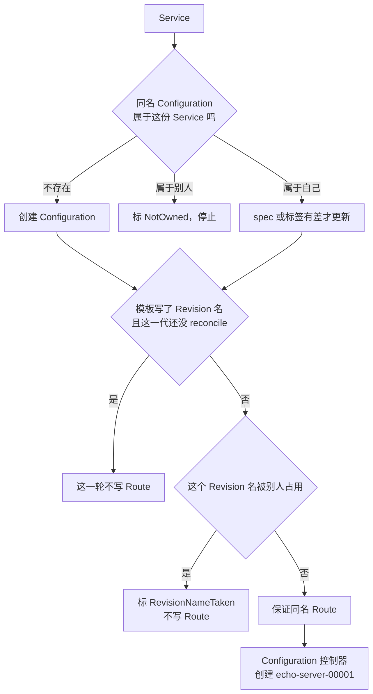

# Service 这一层怎么决定写不写 Route

总图在 [overview.md](./overview.md)。这里只保留 Service 控制器和 Configuration 控制器的分叉。源码是 `knative-serving` 的 `knative-v1.23.0`，commit `7ed4aa2ab601`。

用户提交的 Service 不创建 Pod，也不写 Ingress。它保证同名 Configuration 和同名 Route。Revision 由 Configuration 控制器按 generation 创建。

`echo-server` 的模板没有写 Revision 名，所以走右边：Configuration 还在创建时，Route 也会被保证存在。流量先指向 Configuration 名，status 里再换成具体 Revision。

| 读到的子对象 | 这一轮 |
|---|---|
| 不存在 | 创建。Configuration 和 Route 都用 Service 的名字 |
| 存在，owner 不是这份 Service | 标 NotOwned，不抢，不删 |
| owner 正确，spec / labels / annotations 有差 | 更新这三块。先 SetDefaults，避免只因新默认值就 Update |
| 模板指定了 Revision 名，且该名属于别的 Configuration，或 generation 和 spec 都不相符 | 标名字已占用，不写 Route |
| 模板指定了 Revision 名，但对象还不存在 | 继续写 Route，交给 Configuration 去创建 |

Route 的 traffic 没有 `revisionName` 时，Service 控制器只补上 `configurationName`，不在这里解析成 `echo-server-00001`。解析发生在 Route 自己的控制器，以及 Service 下一轮比较 status 的时候。

Configuration 给 Revision 起名的规则是：名字为空时用 Configuration 名加 `-` 再加五位 generation。generation 1 得到 `echo-server-00001`。Create 若因正常撞名返回 AlreadyExists，这一轮当错误重试，不标创建失败。名字已经属于别的 Configuration 时，标创建失败并且不再重试。

`latestCreatedRevisionName` 在 Revision 创建出来就写，不必等 Ready。`latestReadyRevisionName` 要等拥有的 Revision 里出现 Ready 的那一份。Service 自己的 status 再晚一轮：它看到 Configuration 的 observed generation 跟上之后才抬这个名字。

| 本机 `echo-server` | 值 |
|---|---|
| 入库时准入补上的字段 | 容器名 `user-container`，`containerConcurrency` 0，`timeoutSeconds` 300，`enableServiceLinks` false |
| Route spec | `configurationName: echo-server`，`latestRevision: true`，`percent: 100` |
| Route status traffic | `revisionName: echo-server-00001` |
| 对外 URL | `http://echo-server.default.example.com` |
| 集群内地址 | `http://echo-server.default.svc.cluster.local` |
| 空闲之后 | Service、Configuration、Route 仍 Ready |
