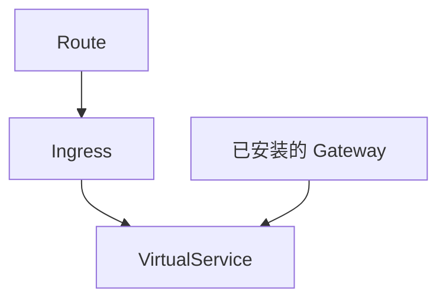

# net-istio 如何把 Ingress 收成 VirtualService

这篇笔记说明 Route 控制器如何把流量写成 `networking.internal.knative.dev/v1alpha1 Ingress`，以及 `net-istio-controller` 如何只处理 Istio 这一类 Ingress，再写成 VirtualService。Service 到 Route 的上半段见 [Service 如何写出 Configuration 和 Route](../serving/service-reconcile.md)。Revision 侧的 public Service 见 [Revision 如何落下 Deployment 和 Service](../serving/revision-children.md)。

两份源码都钉在 tag `knative-v1.23.0`。Serving commit 是 `7ed4aa2ab601e3a33c6552285f6e0d910747351d`。net-istio commit 是 `25e9acac172051c3f9c8873fca520128fc9a1d3a`。

## Route 先写 Ingress

Route 控制器在 Serving 的 `controller` 进程里，注册点是 `cmd/controller/main.go`。`pkg/reconciler/route/controller.go` 监听 Route 自己，以及 owner 是 Route 的 Kubernetes Service、Certificate 和 Ingress。Configuration 和 Revision 通过 tracker 入队，因为流量目标会指向它们。

`ReconcileKind` 在 `pkg/reconciler/route/route.go`。generation 第一次被看到时先 `MarkIngressNotConfigured`，避免子资源还没写成就把 observed generation 报成就绪。`configureTraffic` 失败就返回，不写 Ingress。

流量目标算出来之后，控制器做三件写回：

1. 为每个流量目标写 placeholder Service。`MakeK8sPlaceholderService` 把类型设成 `ExternalName`，用来占住名字。Ingress 有负载均衡状态之后，`updatePlaceholderServices` 再把它们收成指向网关的 Service。
2. 外部域名 TLS 或集群内 TLS 打开时写 Certificate。这个实验的 `cluster/up.sh` 不打开这两项。
3. `reconcileIngress` 写 Ingress。ingress class 先看 Route 注解；注解为空就用 `config-network` 的默认 class。`cluster/up.sh` 把默认 class 设成 `istio.ingress.networking.knative.dev`。

Ingress 名字由 `pkg/reconciler/route/resources/names/names.go` 的 `Ingress` 给出，后缀是空字符串，所以与 Route 同名。`echo-server` 的 Ingress 就是 `ingress.networking.internal.knative.dev/echo-server`。Ingress 的 generation 还没被观察到时，Route 保持未配置。对齐之后才 `PropagateIngressStatus`。

Route 控制器不写 VirtualService。

## net-istio 只收 Istio class

`net-istio` 的 `cmd/controller/main.go` 启动两个构造函数：`ingress.NewController` 和 `serverlessservice.NewController`。Ingress 这一路才处理 Route 写下的 Ingress。

`pkg/reconciler/ingress/controller.go` 用注解 `networking.knative.dev/ingress.class` 过滤。值必须是 `istio.ingress.networking.knative.dev`，常量在 `vendor/knative.dev/networking/pkg/config/config.go` 的 `IstioIngressClassName`。连字符形式 `networking.knative.dev/ingress-class` 是 `IngressClassAnnotationAltKey`，写在 Service 或 Route 上，Serving 再翻译成点号这一条。过滤器读的是点号 key。第三个参数 `true` 表示注解缺失也收下，因此没标 class 的 Ingress 也会进这个控制器。VirtualService 只有 owner 是 Ingress 时才把 owner 入队。

`ReconcileKind` 调 `reconcileIngress`。失败时 Ingress 标未就绪。`config-istio` 把 gateway 关掉时走 `reconcileMeshOnlyIngress`，只写 mesh VirtualService，不探测网关。`cluster/up.sh` 使用发布清单的默认配置，gateway 是开的。

默认外部 Gateway 在 `pkg/reconciler/ingress/config/istio.go` 的 `defaultIngressGateways`。名字是 `knative-serving/knative-ingress-gateway`，背后的 Service 是 `istio-ingressgateway.istio-system`。集群内默认 Gateway 是 `knative-serving/knative-local-gateway`。这两个 Gateway 对象由 net-istio 的安装清单创建，不是每个 Ingress 各写一个。

`shouldReconcileHTTPServer` 只在 Ingress 对外，并且开了外部 TLS 或 `HTTPOption` 为 Redirected 时，才为这一份 Ingress 单独拼 HTTP Server。本实验两条都不满足，所以控制器把 VirtualService 挂到上面那两个默认 Gateway 上。

`MakeVirtualServices` 产出两份对象，名字在 `pkg/reconciler/ingress/resources/names/names.go`：

| 对象 | 名字 | 作用 |
| --- | --- | --- |
| Ingress VirtualService | Ingress 名字加 `-ingress` | 挂到外部或集群内 Gateway |
| mesh VirtualService | Ingress 名字加 `-mesh` | `gateways` 写成 `mesh`，给网格内访问 |

`echo-server` 对应 `virtualservice/echo-server-ingress` 和 `virtualservice/echo-server-mesh`。owner 都是 Ingress。`reconcileVirtualServices` 负责创建、更新和删掉不再需要的旧对象。

写完之后 Ingress 标网络已配置。还没 Ready 时，`statusManager` 通过 Gateway、Endpoints 和 Service 做探测。探测通过才把公网和集群内网关地址写进 `status.loadBalancer`。Route 下一轮读到这份状态，再更新自己的 status。

net-istio 的 SKS 控制器是另一条路。`EnableMeshPodAddressability` 没打开时，`ReconcileKind` 直接返回，不为 SKS 写 VirtualService 或 DestinationRule。本实验不改这个开关。Revision 的 public / private Service 仍由 Serving 的 SKS 控制器写，见上一篇。

## 这次集群上的对象

Ingress `echo-server` 的注解 `networking.knative.dev/ingress.class` 是 `istio.ingress.networking.knative.dev`。集群里只有两份 VirtualService。`echo-server-ingress` 挂着 `knative-serving/knative-ingress-gateway` 和 `knative-serving/knative-local-gateway`。`echo-server-mesh` 的 gateway 是 `mesh`。没有按 Revision 再写一份 VirtualService。
