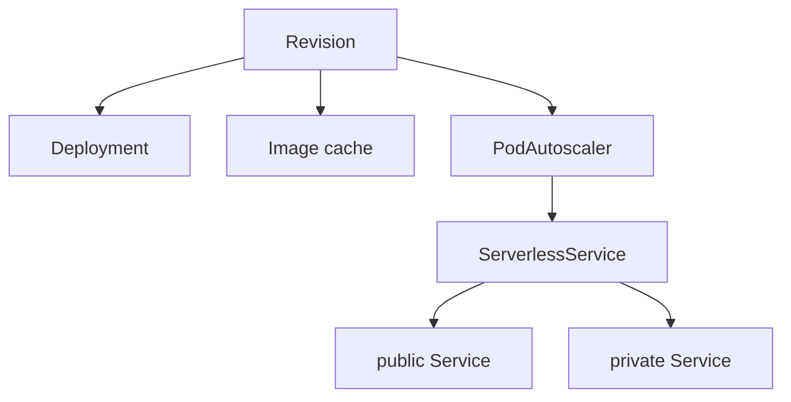

# Revision 如何落下 Deployment 和 Service

这篇笔记说明一个 Revision 如何变成 Deployment 和 PodAutoscaler，以及 PodAutoscaler 之后谁写 ServerlessService，谁再写 public / private Service。Service 到 Revision 的上半段见 [Service 如何写出 Configuration 和 Route](service-reconcile.md)。public Service 的 Endpoints 最终被 VirtualService 使用，Ingress 那一跳见 [net-istio 如何把 Ingress 收成 VirtualService](../net-istio/kingress-to-virtualservice.md)。Queue-Proxy 端口、缩到零之后请求留在 Activator 里的方式，见博客里的数据面笔记，这里不重复。

源码基线是本地 `knative-serving` 检出，tag `knative-v1.23.0`，commit `7ed4aa2ab601e3a33c6552285f6e0d910747351d`。

这三步不在同一个循环里。Revision 控制器和 SKS 控制器在 `cmd/controller/main.go`。KPA 在 `cmd/autoscaler/main.go`。

## Revision 先写 Deployment 和 PodAutoscaler

`pkg/reconciler/revision/controller.go` 监听 Revision，以及 owner 是 Revision 的 Deployment 和 PodAutoscaler。Certificate 通过 tracker 入队。注释写明不监听 Image：Revision 状态不读取 Image 的字段。

`ReconcileKind` 先解析镜像 digest。digest 还没齐就标资源仍在解析并返回，不创建 Deployment。系统内部 TLS 打开时，接着写 queue-proxy 证书。然后按固定顺序调用 `reconcileDeployment`、`reconcileImageCache`、`reconcilePA`。前一步出错，后面的不跑。

| 控制器 | 缓存里看什么 | 写回什么 |
| --- | --- | --- |
| Revision，`controller` 进程 | Revision、Deployment、PodAutoscaler、镜像 digest | Deployment、Image、PodAutoscaler，以及 Revision status |
| KPA，`autoscaler` 进程 | class 为 KPA 的 PodAutoscaler、它拥有的 SKS 和 Metric、带 Revision 标签的 Pod | 内存里的 Decider、ServerlessService，以及 PodAutoscaler status；副本数通过 scaler 写到 Deployment |
| SKS，`controller` 进程 | ServerlessService、它拥有的 Service、private Endpoints、Activator Endpoints | public Service、private Service、public Endpoints |

名字在 `pkg/reconciler/revision/resources/names/names.go`。Deployment 是 Revision 名字加 `-deployment`。PodAutoscaler 用 Revision 自己的名字。generation 为 1 的 `echo-server` 因此是 `echo-server-00001-deployment` 和 `podautoscaler/echo-server-00001`。`cluster/verify.sh` 不写死这个名字，它读 `ksvc` 的 `latestCreatedRevisionName`，再按同一条后缀规则检查子对象。

Deployment 或 PodAutoscaler 已经存在但不由这份 Revision 拥有时，Revision 标资源不可用并返回错误。Deployment 的 spec 与期望不同才更新。有 Ready Pod 时把容器健康标成真。副本数大于 0 但可用副本仍是 0 时，读一个 Pod 的调度和容器状态，写到 Revision。

`reconcilePA` 要求 Deployment 已经能从 lister 读到。PodAutoscaler spec 或 KPA 注解有差才 Update。autoscaling 注解以 Revision 上的值为准，目标对象上多出来的 `autoscaling.knative.dev/` 注解会被删掉，但 class 和 metric 这两个默认注解保留。

Revision 控制器不写 ServerlessService，也不写 Kubernetes Service。

## KPA 写 ServerlessService，再改副本

`pkg/reconciler/autoscaling/kpa/controller.go` 只接收注解 `autoscaling.knative.dev/class` 等于 `kpa.autoscaling.knative.dev` 的 PodAutoscaler。过滤器不允许注解缺失。PodAutoscaler 入库前的默认逻辑会在注解为空时写上配置里的 class，默认类是 KPA，所以 Revision 没写这个注解时，对象进到 informer 之后仍然带 KPA。标成 HPA 的对象不进这个控制器。SKS 和 Metric 必须由这份 PodAutoscaler 拥有才入队。Decider 变化时按 key 把 PodAutoscaler 入队。

`ReconcileKind` 先按 PodAutoscaler 的名字取 SKS。SKS 还不在，或者还没有 `status.privateServiceName` 时，用 Proxy 模式和 2 个 Activator 调用 `ReconcileSKS`，把 PodAutoscaler 标成 SKS 未就绪，然后返回。这一轮不改副本。

SKS 可用之后才做三件事：

1. `reconcileDecider` 在 autoscaler 进程的内存里创建或更新 Decider。这不是 API 对象。
2. `ReconcileMetric` 写出 Metric，供抓取队列指标。
3. `scaler.scale` 按 Decider 的 `desiredScale` 去改 scale target。target 是 Revision 写下的 Deployment。

SKS 模式接着由期望副本和 `excessBurstCapacity` 决定。`want > 0` 且 `excessBurstCapacity >= 0` 时用 Serve。`want` 为 `scaleUnknown`（`-1`）并且 PodAutoscaler 处于 inactive 时保持 Proxy。其余情况也保持函数开头写下的 Proxy。算完之后再 `ReconcileSKS` 一次，把模式和 Activator 数量写进 SKS spec。

`pkg/reconciler/autoscaling/reconciler.go` 的 `ReconcileSKS` 在 ServerlessService 不存在时创建。名字等于 PodAutoscaler 的名字，owner 是 PodAutoscaler。已存在但 owner 不对就标资源不属于自己。spec 有差才 Update。

## SKS 写两个 Service

`pkg/reconciler/serverlessservice/serverlessservice.go` 的顺序是 private Service、public Service、public Endpoints。

private Service 的名字是 SKS 名字加 `-private`。selector 来自 SKS `spec.objectRef` 指向的 Deployment scale 子资源。public Service 用 SKS 自己的名字，spec 里不设 selector。两个 Service 的 owner 都是 SKS。别人占了同名对象时，SKS 标 Endpoints 不属于自己并返回错误。

public Endpoints 的来源由模式决定，代码里的注释把规则写在 `reconcilePublicEndpoints` 前面：

| 条件 | public Endpoints 指向 |
| --- | --- |
| private Service 没有就绪地址 | 改成 Proxy，取 Activator Endpoints 的一个子集 |
| Activator 没有就绪地址 | 改成 Serve，复用 private Endpoints |
| 模式是 Serve | private Endpoints |
| 模式是 Proxy | Activator Endpoints 的子集，数量是 `spec.numActivators` |

`status.serviceName` 是 public Service 的名字，`status.privateServiceName` 是 private Service 的名字。KPA 把后者抄到 PodAutoscaler 的 `metricsServiceName`，把前者抄到 `serviceName`。

## 这次集群上的对象

同一轮验证里，Revision `echo-server-00001` Ready，Deployment `echo-server-00001-deployment` 是 1/1。PodAutoscaler `echo-server-00001` 的 class 注解是 `kpa.autoscaling.knative.dev`。验证脚本打印时 `desiredScale` 还是 `-1`，模式是 Proxy。服务 Ready 之后再次读取，`desiredScale` 和 `actualScale` 都是 1，SKS 模式仍是 Proxy，`numActivators` 是 4。4 是后一次 `ReconcileSKS` 写下的数量。SKS 还不存在时那次调用传入的下限是 2。public Service 和 private Service 分别是 `echo-server-00001`、`echo-server-00001-private`。
