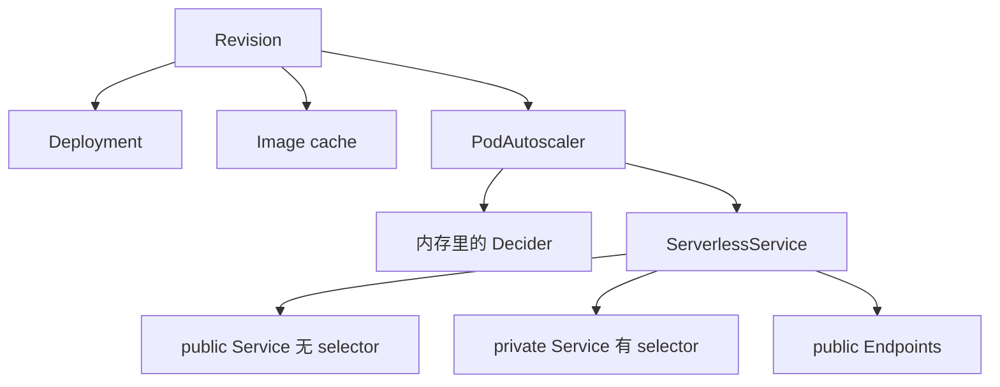

# Revision 如何落下 Deployment 和 Service

这篇笔记说明一个 Revision 如何变成 Deployment 和 PodAutoscaler，KPA 如何写 ServerlessService 并改副本，SKS 如何再写 public Service、private Service 和 public Endpoints。Service 到 Revision 的上半段见 [Service 如何写出 Configuration 和 Route](service-reconcile.md)。public Service 的 Endpoints 最终被 VirtualService 使用，Ingress 那一跳见 [net-istio 如何把 Ingress 收成 VirtualService](../net-istio/kingress-to-virtualservice.md)。

源码基线是本地 `knative-serving` 检出，tag `knative-v1.23.0`，commit `7ed4aa2ab601e3a33c6552285f6e0d910747351d`。

Queue-Proxy 端口、请求在 Activator 里排队的方式，见博客里的数据面笔记。这里只写控制面：谁 watch，谁创建，模式和 Activator 数量怎么算，缩到零之后哪些 status 还保持 True。

## 三步不在同一个循环里

Revision 控制器和 SKS 控制器注册在 `cmd/controller/main.go`。KPA 在 `cmd/autoscaler/main.go`。一份 Revision 要经过三个进程内的循环才变成可以接流量的 Service。前一个循环只写自己的 API 对象，下一个循环靠 Informer 看到新对象再入队。

| 控制器 | 缓存里看什么 | 写回什么 | 明确不写什么 |
| --- | --- | --- | --- |
| Revision，`controller` 进程 | Revision、它拥有的 Deployment 和 PodAutoscaler；Certificate 经 tracker 入队。不 watch Image | Deployment、Image、PodAutoscaler，以及 Revision status | ServerlessService、Kubernetes Service、Endpoints |
| KPA，`autoscaler` 进程 | class 为 KPA 的 PodAutoscaler、它拥有的 SKS 和 Metric、带 Revision 标签的 Pod | 内存里的 Decider、Metric、ServerlessService，以及 PodAutoscaler status。副本经 scaler 写到 Deployment | 不创建 Deployment。HPA class 的对象不进这个控制器 |
| SKS，`controller` 进程 | ServerlessService、它拥有的 Service、private Endpoints、Activator Endpoints | public Service、private Service、public Endpoints | 不改 Deployment 副本，不写 VirtualService |

## Revision 先等 digest

`pkg/reconciler/revision/controller.go` 监听 Revision，以及 owner 是 Revision 的 Deployment 和 PodAutoscaler。注释写明不监听 Image：Revision 状态不读取 Image 的字段。Image 只是按 digest 创建出来的缓存对象，后面的更新不会把 Revision 再入队。

`ReconcileKind` 先 `updateRevisionLoggingURL`。`config-observability` 的 `LoggingURLTemplate` 为空就把 `status.logURL` 清空，否则把 `${REVISION_UID}` 换成 Revision 的 UID。然后 `reconcileDigest`。

digest 已经齐的判断是：`status.containerStatuses` 与 `status.initContainerStatuses` 的个数之和等于 spec 里两类容器的个数之和。齐了就清掉 resolver 里的记录并返回 true。没齐就用 Revision 的 ServiceAccount 和 imagePullSecrets 去解析。解析函数返回错误时，清掉 resolver 以便下次重来，把容器健康标成 False，reason 为 `ContainerMissing`，并把错误返回。解析还没有任何结果时返回 false。`ReconcileKind` 看到 false 就 `MarkResourcesAvailableUnknown`，reason 为 `ResolvingDigests`，然后 `return nil`。这一轮不创建 Deployment。

系统内部 TLS 打开时，digest 之后写 queue-proxy 证书。`cluster/up.sh` 没有开这个开关，`echo-server` 不写这份证书。

然后按固定顺序调用三个阶段，前一个返回错误，后面的不跑：

1. `reconcileDeployment`
2. `reconcileImageCache`
3. `reconcilePA`

一轮开始前和结束后各看一次 Revision Ready。从假变成真时发 Normal 事件 `RevisionReady`。从真变成假只打日志。删除 Revision 时 `ObserveDeletion` 让 resolver 忘掉这个键。

## Deployment 的名字、所有权和崩溃状态

名字在 `pkg/reconciler/revision/resources/names/names.go`。Deployment 是 `kmeta.ChildName(revision.Name, "-deployment")`。PodAutoscaler 用 Revision 自己的名字。Image 缓存的前缀是 Revision 名字加 `-cache`，再加 `-` 和容器名。generation 为 1 且容器名是准入默认的 `user-container` 时，`echo-server` 的三份对象是：

| 对象 | 名字 |
| --- | --- |
| Deployment | `echo-server-00001-deployment` |
| PodAutoscaler | `echo-server-00001` |
| Image | `echo-server-00001-cache-user-container` |

`cluster/verify.sh` 不写死 Revision 名。它读 `ksvc` 的 `latestCreatedRevisionName`，再按同一条后缀规则检查子对象。

Deployment 不存在时，Revision 把 ResourcesAvailable 和 ContainerHealthy 都标成 Unknown，reason 为 `Deploying`，然后创建并返回。这一轮不再往下看副本。创建失败则返回错误。

Deployment 存在但不由这份 Revision 拥有时，`MarkResourcesAvailableFalse`，reason 为 `NotOwned`，返回错误。控制器不改那份 Deployment。

owner 正确时 `checkAndUpdateDeployment`，spec 与期望不同才更新。然后 `PropagateDeploymentStatus`。若 `spec.replicas > 0` 但 `availableReplicas` 仍是 0，就按 Deployment 的 selector 列 Pod，`Limit` 为 1，拿第一个 Pod 解释失败原因。`PodIsAlwaysSchedulable` 为假时，PodScheduled 为 False 会把调度失败的 reason 和 message 写到 Revision。用户容器（不是 queue-proxy）如果已经终止，按退出码标 ContainerHealthy False。退出码是 0 且没有 message 时，仍写一条 `container exited with no error`。容器还在 Waiting，并且 Deployment 已经超时，则标 ResourcesAvailable False。列 Pod 失败只打日志并返回 nil，不把这次列表错误变成 Revision 失败。`readyReplicas > 0` 时把容器健康标成真。

## Image 和 PodAutoscaler

`reconcileImageCache` 对每个已经解析出 digest 的用户容器和 init 容器各看一份 Image。不存在就创建。存在就跳过，不比较 spec。注释说明 Revision 不可变，换镜像会产生新 Revision，所以这里不处理旧缓存的泄漏。

`reconcilePA` 先从 lister 读 Deployment。刚创建的 Deployment 可能还没进缓存，这时 Get 的错误直接返回，Revision 这一轮失败并重试。PodAutoscaler 不存在就 `MakePA` 再创建。存在但不属于这份 Revision，同样标 `NotOwned` 并返回错误。

owner 正确时，先把 PodAutoscaler status 传播到 Revision，再比较期望 spec 和 KPA 注解。`autoscaling.knative.dev/` 前缀的注解以 Revision 上的值为准，目标对象上多出来的会被删掉。class 和 metric 这两个默认注解保留，避免把准入已经写上的默认值删掉。

`MakePA` 不写死 class。`pkg/apis/autoscaling/v1alpha1/pa_defaults.go` 在注解缺失时，从配置写入 `autoscaling.knative.dev/class`。`pkg/autoscaler/config/config.go` 的 `PodAutoscalerClass` 默认是 `autoscaling.KPA`，也就是 `kpa.autoscaling.knative.dev`。KPA 控制器的过滤器是 `AnnotationFilterFunc(..., false)`，缺失注解不算命中。所以 HPA class 的对象不进 KPA。没写 class 的 Revision 经过准入之后，informer 里看到的仍然是 KPA。

Revision 控制器到此为止。ServerlessService 和 Kubernetes Service 由后面两个控制器写。

## KPA 先要有 private Service 名

`pkg/reconciler/autoscaling/kpa/controller.go` 只接收 class 注解等于 `kpa.autoscaling.knative.dev` 的 PodAutoscaler。SKS 和 Metric 必须由这份 PodAutoscaler 拥有才入队。Decider 变化时按 PodAutoscaler 的 key 入队。Decider 不是 API 对象，它活在 autoscaler 进程的内存里。进程重启后 Decider 消失，下一次 reconcile 会重建。`ObserveDeletion` 在 PodAutoscaler 删除时删掉对应 Decider 和指标。

`ReconcileKind` 用 PodAutoscaler 的名字取 SKS，`autoscaling/resources/names.SKS` 没有另加后缀。SKS 不在，或者 `status.privateServiceName` 还是空，就用 Proxy 模式和 `minActivators`（常量 2）调用 `ReconcileSKS`，把 PodAutoscaler 标成 SKS 未就绪，`computeStatus` 的 `want` 用 `scaleUnknown`（-1），然后返回。这一轮不调用 `scaler.scale`，不改 Deployment 副本。注释说明这时还没有真实的 Activator 数量，2 只是起步值。

SKS 可用之后做三件事，前一件失败就返回：

1. `reconcileDecider`。`MakeDecider` 从 PodAutoscaler 注解和 autoscaler 配置拼出期望 Decider。内存里没有就 Create。比较时忽略 status。spec 有差才 Update。
2. `ReconcileMetric`。写出 Metric，供抓取队列指标。`status.metricsServiceName` 在这之前已经抄成 SKS 的 `privateServiceName`。
3. `scaler.scale`。按 Decider 的 `desiredScale` 去改 scale target。target 是 Revision 写下的 Deployment。

## 模式和 Activator 数量是两次写入

模式的初值是 Proxy，然后只改两种情况。

| 条件 | 模式 |
| --- | --- |
| `want == -1` 且 PodAutoscaler 处于 inactive | 保持 Proxy。注释说明 autoscaler 刚重启、还没有指标，但这份 Revision 以前已经缩到零 |
| `want > 0` 且 `decider.Status.ExcessBurstCapacity >= 0` | Serve。这时把 Activator 移出数据路径 |
| 其余，包括 `want > 0` 但多余突发容量为负 | 保持函数开头的 Proxy |

算完再 `ReconcileSKS` 一次，把模式和 Activator 数量写进 SKS spec。SKS Ready 时 PodAutoscaler 标 SKSReady，否则把 SKS Ready condition 的 message 抄上来。`status.serviceName` 抄 SKS 的 public Service 名。

`computeStatus` 把就绪 Pod 数写成 `actualScale`。`want` 为 -1 且当前 `desiredScale` 已经大于等于 0 时，不把期望副本改回 -1。注释说明进程刚重启时会短暂算出 -1，马上又回到正确值，这层是为了不把 status 抖一下。其他情况按 `want` 写 `desiredScale`。

Activator 数量在 `computeNumActivators`。`target-burst-capacity` 为 0 时直接返回 2。大于 0 时，要覆盖的容量是 `readyPods * TotalValue + TargetBurstCapacity`，再除以 `activator-capacity` 向上取整，并且不小于 2。`TargetBurstCapacity` 为 -1 时不加这一项，只按就绪 Pod 的 `TotalValue` 除。`TotalValue` 来自 `ResolveMetricTarget`：指标默认是并发，`containerConcurrency` 为 0 时用 `container-concurrency-target-default`。

`pkg/autoscaler/config/config.go` 的 `defaultConfig` 与这次实验有关的值是：

| 配置 | 默认 |
| --- | --- |
| `enable-scale-to-zero` | true |
| `container-concurrency-target-default` | 100 |
| `container-concurrency-target-percentage` | 0.7。这是比例，目标并发是 `TotalValue * 0.7`。键名带 percentage，缺省值不是整数 70 |
| `target-burst-capacity` | 211 |
| `activator-capacity` | 100 |
| `initial-scale` | 1 |
| `allow-zero-initial-scale` | false |
| `scale-to-zero-grace-period` | 30 秒 |
| `scale-to-zero-pod-retention-period` | 0 |
| PodAutoscaler class | `kpa.autoscaling.knative.dev` |

`config-autoscaler` 的示例写在 `_example` 里，不是生效的 data。这个实验没有另写这些键，所以用的是上表。`echo-server` 的 `containerConcurrency` 是 0，`TotalValue` 因此是 100。

新建 Decider 时，`MultiScaler.createScaler` 先把 `desiredScale` 设为 -1。`target-burst-capacity` 大于 0 时，初始 `excessBurstCapacity` 是 `initialScale * TotalValue - targetBurstCapacity`。代入默认值是 `1 * 100 - 211 = -111`。负值不满足 Serve 的 `>= 0`，所以刚启动时即使期望副本已经大于 0，SKS 仍保持 Proxy。

就绪 Pod 为 1 时，Activator 数量是 `ceil((1 * 100 + 211) / 100) = 4`。就绪 Pod 为 0 时是 `ceil((0 * 100 + 211) / 100) = 3`。两次都大于下限 2。集群上的两次读取和这两个结果一致，见文末。

`pkg/reconciler/autoscaling/reconciler.go` 的 `ReconcileSKS` 在 ServerlessService 不存在时创建。名字等于 PodAutoscaler 的名字，owner 是 PodAutoscaler，spec 带上这次的 Mode、ObjectRef、ProtocolType 和 NumActivators。已存在但 owner 不对就标资源不属于自己。spec 有差才 Update。

## SKS 写两个 Service，再决定 Endpoints 指向谁

`pkg/reconciler/serverlessservice/serverlessservice.go` 的顺序是 private Service、public Service、public Endpoints。前一步失败，后面不跑。

private Service 的名字是 SKS 名字加 `-private`。selector 来自 SKS `spec.objectRef` 指向的 Deployment scale 子资源，所以它选中的是用户 Pod。public Service 用 SKS 自己的名字，spec 里不设 selector。没有 selector 的 Service 不会由 kube-controller-manager 自动填 Endpoints，必须由 SKS 控制器写。两个 Service 的 owner 都是 SKS。别人占了同名对象时，SKS 标 Endpoints 不属于自己并返回错误。

public Endpoints 的来源由模式决定。代码注释把规则写在 `reconcilePublicEndpoints` 前面，实现比 spec 里的 mode 多两层覆盖，因为 public Endpoints 不能留空，VirtualService 用的就是它们。

| 条件 | 实际使用的地址 |
| --- | --- |
| private Service 没有就绪地址 | 先把本轮模式改成 Proxy，即使 spec 写的是 Serve |
| Activator 没有就绪地址 | 再改成 Serve，复用 private Endpoints |
| 最终模式是 Serve | private Endpoints |
| 最终模式是 Proxy | Activator Endpoints 的子集，个数是 `spec.numActivators` |

private 有就绪地址时 `MarkEndpointsReady`，否则 `MarkEndpointsNotReady`，reason 为 `NoHealthyBackends`。没有后端，或者 spec 模式仍是 Proxy 时，`MarkActivatorEndpointsPopulated`。Serve 且 private 有地址时，`MarkActivatorEndpointsRemoved`。

`status.serviceName` 是 public Service 的名字，`status.privateServiceName` 是 private Service 的名字。KPA 把后者抄到 PodAutoscaler 的 `metricsServiceName`，把前者抄到 `serviceName`。

## 这次集群上的对象

验证脚本打印时，Revision `echo-server-00001` 已经 Ready，Deployment `echo-server-00001-deployment` 是 1/1。PodAutoscaler 的 class 注解是 `kpa.autoscaling.knative.dev`，`desiredScale` 还是 -1，SKS 模式是 Proxy。这和 Decider 刚创建时 `desiredScale` 先写成 -1、多余突发容量为负所以保持 Proxy 的路径一致。服务 Ready 之后马上再读，`desiredScale` 和 `actualScale` 都是 1，模式仍是 Proxy，`numActivators` 是 4。4 对得上就绪 Pod 为 1 时的默认算式，不是 SKS 缺失时那次调用传入的下限 2。

Image `echo-server-00001-cache-user-container` 存在，镜像已经解析成 `ghcr.io/knative/helloworld-go@sha256:a97656c57f547d668318eb45c4c44c4cb0667892c055b40355b37859918c5c18`。public Service 和 private Service 分别是 `echo-server-00001`、`echo-server-00001-private`。

空闲之后再次读取，`default` 命名空间里没有 Pod。PodAutoscaler 的 `desiredScale` 和 `actualScale` 都是 0。Active 和 Ready 都是 False，reason 为 `NoTraffic`，message 是 `The target is not receiving traffic.`。ScaleTargetInitialized 仍是 True。SKS spec 仍是 Proxy，`numActivators` 变成 3，对得上就绪 Pod 为 0 时的算式。ActivatorEndpointsPopulated 为 True，message 是 `Revision is backed by Activator`。EndpointsPopulated 和 SKS Ready 是 Unknown，reason 为 `NoHealthyBackends`。Revision 的 Ready、ContainerHealthy、ResourcesAvailable 仍是 True，只有 Active 变成 False。Service 和 Route 也仍是 Ready。缩到零拿掉的是 Pod，不是 Revision 的 Ready，也不是对外的 Route。
