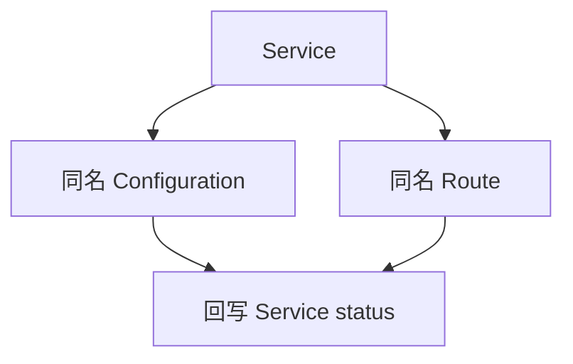

# Service 如何写出 Configuration 和 Route

这篇笔记说明用户提交一个 `serving.knative.dev/v1 Service` 之后，控制器如何保证同名 Configuration 和 Route 存在，以及 Configuration 控制器如何为当前 generation 再写一个 Revision。Revision 往下写的 Deployment 和 PodAutoscaler 见 [Revision 如何落下 Deployment 和 Service](revision-children.md)。Route 写出的 Ingress 见 [net-istio 如何把 Ingress 收成 VirtualService](../net-istio/kingress-to-virtualservice.md)。

源码基线是本地 `knative-serving` 检出，tag `knative-v1.23.0`，commit `7ed4aa2ab601e3a33c6552285f6e0d910747351d`。

Service、Configuration、Route、Revision 的控制器都注册在 `cmd/controller/main.go` 的 `ctors` 里，跑在 `controller` 这一个进程。KPA 不在这里，它注册在 `cmd/autoscaler/main.go`。

## Service 控制器看什么

`pkg/reconciler/service/controller.go` 的 `NewController` 拿四份 Informer。Service 的增删改直接入队。Configuration 和 Route 先过 `FilterController(&v1.Service{})`，只有 owner 是 Service 时才把 owner 入队。Revision Informer 只给 lister 用，没有挂事件处理。

| 缓存里看什么 | 写回什么 |
| --- | --- |
| Service | 同名 Configuration、同名 Route，以及 Service status |
| Configuration、Route | 拥有它们的 Service 再次入队 |

名字函数在 `pkg/reconciler/service/resources/names/names.go`。Configuration 和 Route 都直接用 Service 的名字。`samples/echo-server.yaml` 因此对应 `configuration/echo-server` 和 `route/echo-server`。

## 一轮只处理这一份 Service

`ReconcileKind` 在 `pkg/reconciler/service/service.go`。顺序是先 Configuration，再 Route，最后用两边的 status 填 Service。

`Config` 用 Service 名字取 Configuration。不存在就 `MakeConfiguration` 然后创建。对象在，但 owner 不是这份 Service，就 `MarkConfigurationNotOwned` 并返回错误，不会抢别人的对象。对象已属于这份 Service 时，`reconcileConfiguration` 比较 spec、labels、annotations。相等就不动。不相等就把现有对象的这三块改成期望值再 Update。`MakeConfigurationFromExisting` 把 `spec` 设成 `service.Spec.ConfigurationSpec`，加上 `serving.knative.dev/service` 和 `serving.knative.dev/serviceUID`，并在 annotation `serving.knative.dev/routes` 里放上同名 Route。`kubectl.kubernetes.io/last-applied-configuration` 和 rollout duration 注解不会抄过去。

Configuration 的 `metadata.generation` 还不等于 `status.observedGeneration` 时，Service 被标成 Configuration 尚未 reconcile。模板里如果写了 Revision 名字，也就是 BYO Revision，函数在这里返回，先不写 Route。注释说明这是为了串行：等 Configuration 跟上这一代，再改流量。

`CheckNameAvailability` 只在模板写了 Revision 名字时生效。那个 Revision 必须由这份 Configuration 拥有，并且 `serving.knative.dev/configurationGeneration` 对得上，或者 spec 与模板一致。否则 Service 被标成名字已被占用，这一轮不写 Route。

Route 走同一套所有权检查。`MakeRoute` 把 `spec` 设成 `service.Spec.RouteSpec`。traffic 项没有 `revisionName` 时，补上这份 Service 的 Configuration 名字。spec、labels、annotations 有差才 Update。

Route 的 generation 还没被自己的控制器观察到时，Service 标 Route 尚未 reconcile。两边 generation 都对齐之后，`PropagateConfigurationStatus` 和 `PropagateRouteStatus` 把子对象状态抬上来。`checkRoutesNotReady` 再对一遍：Route spec 里指向 Configuration 的流量项，会先换成该 Configuration 的 `latestReadyRevisionName`，再和 status 里的 traffic 比较。对不上就标 Route 还没就绪。URL 和 `latestRevision` 字段不参与这次比较。

Service 控制器不创建 Revision，也不写 Deployment。

## Configuration 再写 Revision

`pkg/reconciler/configuration/controller.go` 监听 Configuration 自己，以及 owner 是 Configuration 的 Revision。`ReconcileKind` 先找当前 generation 应该存在的 Revision。找不到就 `createRevision`。`pkg/reconciler/configuration/resources/revision.go` 的 `MakeRevision` 在模板没写名字时用 `configuration.Name` 加五位 generation。generation 为 1 时，`echo-server` 的 Revision 名字是 `echo-server-00001`。owner 是 Configuration。

创建成功后，status 写 `latestCreatedRevisionName`。最新创建的 Revision 就绪时，再在拥有的 Revision 里从新到旧找最后一个 Ready，写入 `latestReadyRevisionName`。名字冲突或创建失败时，Configuration 标 Revision 创建失败，不继续改 `latestReadyRevisionName`。

Service 自己的 status 要等下一轮，看到 Configuration 的 observed generation 对齐之后，才会把这个 Revision 名字抬上去。

## 这次集群上的对象

`cluster/verify.sh` 在 kind 集群 `knative` 上创建 `service.serving.knative.dev/echo-server`。Ready 之后，Configuration `echo-server` 的 `latestCreatedRevisionName` 和 `latestReadyRevisionName` 都是 `echo-server-00001`。Route `echo-server` 的 URL 是 `http://echo-server.default.example.com`。`curl -H "Host: echo-server.default.example.com" http://127.0.0.1:18080` 的响应体是 `Hello World!`。
